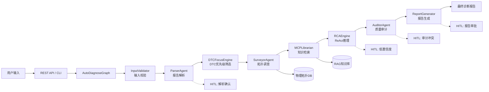

# AutoDiagnose 智能诊断平台 — 项目演示文档

> **文档版本**: v1.0.0  
> **创建日期**: 2026-05-14  
> **目标读者**: 管理层 / 技术决策者  
> **项目代号**: AI Disgnostic  

---

## 目录

1. [项目概述](#1-项目概述)
2. [核心架构设计](#2-核心架构设计)
3. [技术栈选型](#3-技术栈选型)
4. [项目核心亮点](#4-项目核心亮点)
5. [详细使用方法](#5-详细使用方法)
6. [项目当前进展与未来规划](#6-项目当前进展与未来规划)

---

## 1. 项目概述

### 1.1 一句话描述

**AutoDiagnose** 是一个基于多智能体协同（Multi-Agent）与 LangGraph 状态图引擎的车辆电检报告智能诊断平台，针对 100+ ECU、5 域控的复杂车载网络场景，实现从电检报告输入到根因分析报告输出的全流程自动化。

### 1.2 解决的核心问题

传统电检诊断面临三大痛点：

| 痛点 | 传统方案 | AutoDiagnose 方案 |
|------|----------|-------------------|
| **DTC 数量庞大** | 人工逐条排查，效率低 | 智能优先级排序 + 症状匹配，聚焦关键 DTC |
| **推理缺乏约束** | 诊断完全依赖个人经验 | 物理拓扑图约束推理，杜绝"幻觉" |
| **结果不可追溯** | 无审计记录，责任模糊 | 全链路 Checkpoint + 审计日志，完整可追溯 |

### 1.3 核心价值主张

```
电检报告 + 用户症状 → [Multi-Agent 协同诊断] → RCA 根因报告 + 置信度 + 维修建议
```

---

## 2. 核心架构设计

### 2.1 系统分层架构

系统采用 **七层架构** 设计，各层职责清晰、边界明确：

```
┌─────────────────────────────────────────────────────────────────┐
│                    1. 用户交互层 (Interaction)                    │
│          CLI 命令行 (main.py)  │  REST API (FastAPI)             │
├─────────────────────────────────────────────────────────────────┤
│                    2. 编排引擎层 (Orchestration)                  │
│     AutoDiagnoseGraph (LangGraph StateGraph + SQLite Checkpoint) │
├─────────────────────────────────────────────────────────────────┤
│                    3. Agent 节点层 (Agent Nodes)                  │
│  InputValidator → Parser → DTCFocus → Surveyor → MCPLibrarian   │
│             → RCAEngine → Auditor → ReportGenerator             │
├─────────────────────────────────────────────────────────────────┤
│                    4. 人工介入层 (HITL)                           │
│    解析确认  │  低置信度决策  │  审计冲突仲裁  │  报告审批          │
├─────────────────────────────────────────────────────────────────┤
│                    5. 工具与知识层 (Tools & Knowledge)            │
│   ToolRegistry  │  DTC Database  │  Topology DB  │  RAG (MCP)    │
├─────────────────────────────────────────────────────────────────┤
│                    6. LLM Provider 层                            │
│        Cloud LLM (阿里百炼)  │  Local LLM (llama.cpp)            │
│                    多层降级 (Fallback)                            │
├─────────────────────────────────────────────────────────────────┤
│                    7. 持久化层 (Persistence)                      │
│     SQLite Checkpoint  │  JSON 状态文件  │  Vector DB (语义索引)  │
└─────────────────────────────────────────────────────────────────┘
```

### 2.2 核心组件交互关系



### 2.3 核心数据流

```
用户输入 (raw_input + user_context)
  │
  ▼
┌──────────────┐     ┌───────────────┐     ┌──────────────┐
│ InputValidator│────▶│ ParserAgent   │────▶│ DTCFocusEngine│
│ 格式校验       │     │ 结构化解析     │     │ 优先级排序     │
│ 敏感信息过滤   │     │ LLM提取DTC/ECU │     │ 症状匹配       │
└──────────────┘     └───────────────┘     └──────────────┘
                                                   │
                          ┌─────────────────────────┤
                          ▼                         ▼
                  ┌──────────────┐         ┌──────────────┐
                  │SurveyorAgent │         │MCPLibrarian  │
                  │ 物理拓扑采集   │         │ RAG知识检索   │
                  │ 2层子图查询   │         │ DTC定义+案例  │
                  └──────────────┘         └──────────────┘
                          │                         │
                          └──────────┬──────────────┘
                                     ▼
                            ┌──────────────┐
                            │  RCAEngine   │
                            │  ReAct推理   │
                            │  置信度计算   │
                            └──────────────┘
                                     │
                                     ▼
                            ┌──────────────┐
                            │ AuditorAgent │
                            │ 5项质量审计   │
                            │ 冲突检测      │
                            └──────────────┘
                                     │
                                     ▼
                            ┌──────────────┐
                            │ReportGenerator│
                            │ 报告组装       │
                            │ 维修建议       │
                            └──────────────┘
                                     │
                                     ▼
                              最终诊断报告
```

### 2.4 LangGraph 状态流转机制

系统基于 **LangGraph StateGraph** 实现有向条件图编排，每个节点输出驱动下一个节点选择：

| 状态节点 | 正常流转 | HITL 触发条件 | 错误处理 |
|----------|---------|---------------|----------|
| InputValidator | → Parser | — | → END (exit_code=1) |
| ParserAgent | → DTCFocus | DTC > 10 需确认 | → 重试(最多3次) / Fallback |
| DTCFocusEngine | → Surveyor | DTC > 10 | — |
| SurveyorAgent | → MCPLibrarian | — | → 跳过(拓扑为空) |
| MCPLibrarianAgent | → RCAEngine | — | → 降级(本地知识) |
| RCAEngine | → Auditor | 置信度 < 0.7 | → 重试(最多3次) |
| AuditorAgent | → 报告审批 | 存在冲突 | → 重分析(最多2次) |
| 报告审批 | → ReportGenerator | 最终人工审批 | — |

---

## 3. 技术栈选型

### 3.1 核心技术一览

| 类别 | 技术选型 | 版本 | 选型